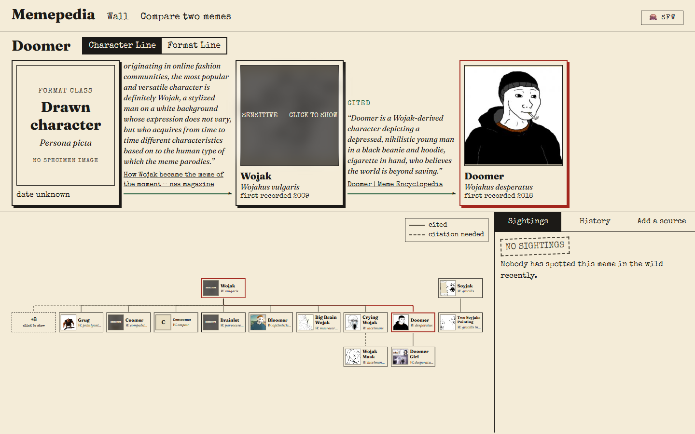
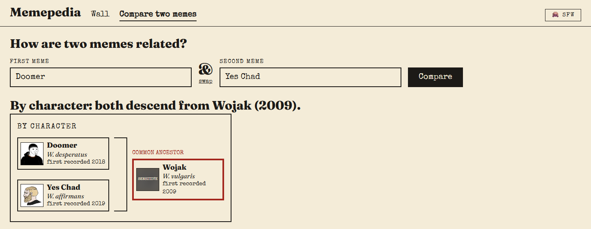
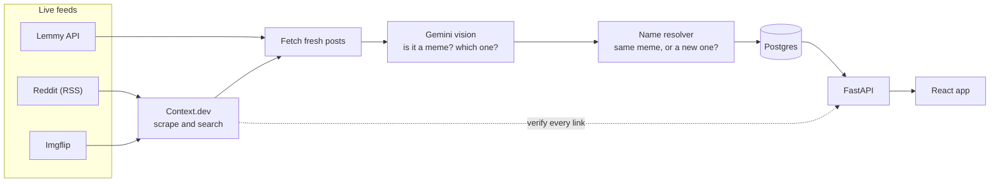
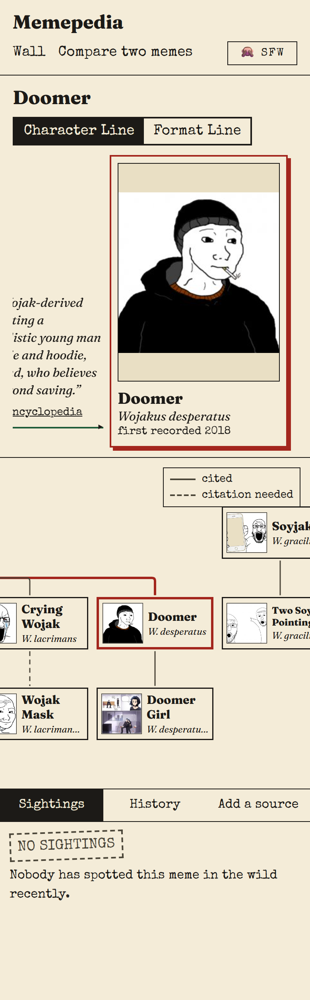

# 🧬 Memepedia

### The open family tree of internet culture. Every meme has ancestors. We cite them.


**Live demo:** <https://aleksandr-shishkov-work--memepedia-web.us-east.modal.run>



---

## 😤 The problem

Your uncle just posted a Doomer. You have questions.

| | |
|---|---|
| 🚫 | Scrolling past a meme and wondering where on earth it came from |
| ✅ | Tracing it back to 2009, with a **quoted source on every single link** |

Memes are the folk art of the internet, and they are disappearing: platforms lock down, posts get
deleted, and nobody writes down who descended from whom. Memepedia is a **live meme genealogy**.
It watches social feeds, recognises what it sees, files each post under the right meme family, and can
trace any meme back to its origin.

> **Change my mind:** every link in a family tree deserves a citation. 🪑☕

## 🎪 What you can do

| | |
|---|---|
| 🌊 **The Wall** | Posts seen on Lemmy, Reddit and Imgflip minutes ago, each one stamped with the family it belongs to. If we are not sure, it says **unidentified**. We would rather admit it than guess. |
| 🧬 **Lineage** | Open any meme and see its line of descent back to a root, plus the whole family as a map. Two lines: **character** (who it is about) and **format** (how it is built). |
| 📜 **Cited or "citation needed"** | A link with a verbatim quote from a real web page is solid. A link we could not source is drawn **dashed**, with a stamp. No vibes-based history. |
| 🔬 **Trace anything** | Type a meme we have never heard of. An agent drafts its ancestry, then goes to the web to verify each link, streaming its progress as it goes. |
| 🥊 **Compare two memes** | Pick two memes, press **Compare**, and see where their families meet. |
| 🖼️ **Drop an image** | Drag in a picture and we tell you which meme it is, or offer to trace it. |
| 📅 **This week in memes** | Families on the rise and brand-new specimens, with no fake spikes (a meme needs real evidence to count as rising). |
| ✍️ **Add a source** | Know a page that explains a meme's origin? Submit it. If it names both memes in one sentence, the link becomes cited. |
| 🙈 / 👀 **SFW / NSFW** | A header toggle. SFW by default: anything flagged or unlabelled stays hidden or blurred until you ask. |
| 📱 **Pocket-sized** | The whole thing works on a phone. |



### The museum theme 🏛️

Memepedia is styled as a natural-history museum of the internet. Memes are **specimens** with a
first-recorded date and a (shamelessly invented) Latin name: *Wojakus desperatus*, *Persona picta*.
When a brand-new meme starts showing up across several authors, it is catalogued as a fresh
**specimen** until someone confirms it.

## 🧠 How the citations work

The expanding-brain version:

| | |
|---|---|
| 🧠 | An LLM **guesses** a lineage: this meme descends from that one, which descends from that format |
| 🧠🧠 | We **search the web** for each pair of names and read the top pages |
| 🧠🧠🧠 | A link only counts as **cited** if a sentence naming both appears **word for word** on the page. We check that with a plain substring test, so the model cannot invent a quote |
| 🌌 | No quote found? The link stays **inferred**, drawn dashed, with a "citation needed" stamp |

Hard rules: a parent is never younger than its child, there are no cycles, and every meme ends at one
of about ten **format roots** (image macro, reaction image, drawn character, comparison, video remix,
copypasta and friends), so no family tree is ever left floating.

## 🔭 How a post becomes a sighting

*Is this a meme?* 🦋



1. **Fetch**: fresh posts from 9 Lemmy communities, 5 subreddits and 2 Imgflip streams.
2. **Look**: one Gemini vision call per image returns structure, not prose: its best template guess,
   how confident it is, the characters in it, and any overlaid text.
3. **Resolve**: the guess is matched to a meme in the archive. A post is stamped only when the model is
   confident and the name matches a known meme, or when it clearly shows one known character. Otherwise
   it stays **unidentified**.
4. **Notice new memes**: unidentified posts are grouped. If three or more, from at least two different
   people, share a structure, the cluster becomes a new specimen and is traced.

### Distracted-boyfriend summary

```
   🧑  Me                 👩  A meme I already understand        👩‍🦰  A brand-new meme with a
   (a researcher)              (Doomer, Doge, Drake)                  suspiciously Italian name
        👀 ───────────────────────────────────────────────────────────▶
                         "Where did this one come from?"
```

## 🛠️ Built with

| | |
|---|---|
| **Backend** | Python 3.12, FastAPI, [uv](https://docs.astral.sh/uv/), PostgreSQL, Pydantic |
| **The web, as a database** | [Context.dev](https://context.dev): scraping, search and page monitors |
| **The eyes and the brain** | Google Gemini (vision for images, text for lineage and quotes) |
| **Frontend** | React 19, TypeScript, Vite, Tailwind CSS 4, React Flow (the family map), Motion |
| **Hosting** | Modal (API and site on one URL), Aiven (Postgres) |

The backend and the frontend meet only at [`contract/`](contract): one TypeScript file describes every
JSON shape, and a folder of fixtures lets the frontend run with no backend at all.

## 🚀 Run it yourself

You need [uv](https://docs.astral.sh/uv/) and Node.js.

```bash
# 1. Backend (a local Postgres starts itself on first use; no Docker needed)
cd backend
uv run python scripts/load_fixtures.py --reset      # fill a local dev database with the mock archive
uv run uvicorn memepedia.api:app --port 8000

# 2. Frontend, in another terminal
cd web
npm install
VITE_API_BASE=http://localhost:8000 npm run dev      # leave VITE_API_BASE unset to run on fixtures only
```

The live pipeline, tracing and image lookup need keys in a repo-root `.env` (git-ignored):

```
CONTEXTDOTDEV_KEY=...
GEMINI_KEY=...
DATABASE_URL=...        # optional: a hosted Postgres instead of the local one
```

```bash
cd backend
uv run pytest -q                     # tests (Linux or WSL: the database guard refuses Windows)
uv run ruff check . && uv run mypy memepedia scripts
```

> ⚠️ With `DATABASE_URL` set, every script talks to **that** database. The fixture loader refuses to run
> unless the database is the local dev one, for exactly this reason.



## 🗺️ Where things live

```
backend/     FastAPI app, the live loop, tracing, the Gemini and Context.dev clients, tests
web/         the React app
contract/    the JSON shapes both halves agree on, plus mock data for every endpoint
claude_docs/ the plans, the current STATUS.md (start here if you are picking the project up)
spikes/      the early experiments that decided what was feasible
```

## 🤝 Ground rules

- 🚫 **Know Your Meme is not scraped.** Its terms forbid it. We link out and never aggregate.
- 🛡️ **Demo-safe by default.** Posts flagged or not yet labelled as NSFW never appear unless you switch
  the toggle on, and node images stay blurred until you click.
- 🕊️ **An open commons.** The model is Wikipedia's: open code, open data, no advertising.
- 🧾 **Honesty over hype.** Unsure means "unidentified" or "citation needed", never a confident guess.

## 🔥 This is fine

It is a hackathon project, so some edges are rough: tracing a brand-new meme can take a couple of
minutes, not every link has found its quote yet, and the live clock is paused to save credits. The
honest, current list is in [`claude_docs/STATUS.md`](claude_docs/STATUS.md).

## 📚 Read more

- [`claude_docs/STATUS.md`](claude_docs/STATUS.md): what is done, what is not, decisions made
- [`claude_docs/plans/2026-11-14_meme-genealogy_plan.md`](claude_docs/plans/2026-11-14_meme-genealogy_plan.md): the product and the logic
- [`contract/README.md`](contract/README.md): the API and the data shapes

---

Built at **Junction 2026** by a team of two, with a lot of help from Claude. 🤖

*No memes were harmed in the making of this family tree. A few were blurred.*
